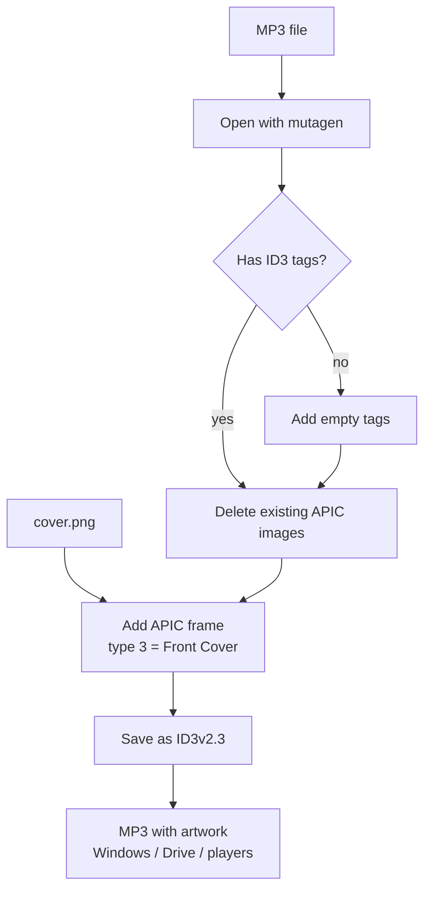

# Music Cover Maker

A small Python utility that embeds cover art into an MP3's ID3 tags so the artwork actually shows up in Windows Explorer, Google Drive, and music players.

> Built to fix a real problem: audiobook MP3s I generated showed a blank thumbnail in Google Drive. The fix was writing the image as a *Front Cover* APIC frame and saving in the older ID3v2.3 format that Drive and Windows read reliably.

## How it works


1. Opens the MP3 and adds ID3 tags if missing
2. Removes any existing (possibly broken) embedded images
3. Embeds your image as the **Front Cover** (APIC type 3)
4. Saves as **ID3v2.3** for maximum compatibility

## Usage
```bash
pip install -r requirements.txt
```
Edit `AUDIO_FILE` and `IMAGE_FILE` at the top of `Music_Cover_Maker.py`, then:
```bash
python Music_Cover_Maker.py
```
Output:
```text
🎨 Embedding 'cover.png' into 'Apple_in_China_Complete.mp3'...
✅ Success! Saved with ID3v2.3 compatibility.
```
